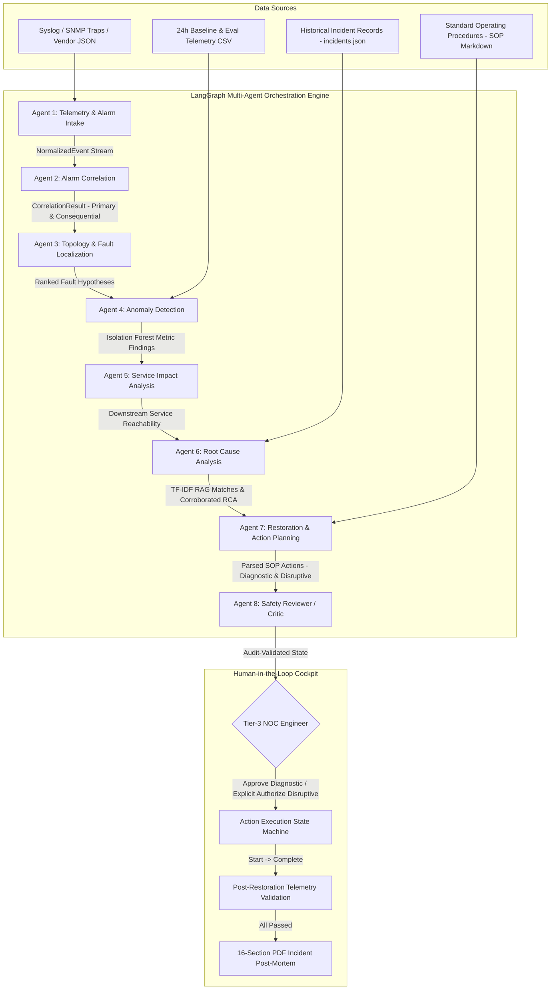

# Agentic AI Telecom Network Fault Diagnosis & Service Restoration System

A Network Operations Center (NOC) **decision-support platform** utilizing 8 specialized AI agents orchestrated via LangGraph to correlate alarms, localize physical and logical faults, detect telemetry anomalies, evaluate service impacts, deduce root causes through historical RAG, formulate safe Standard Operating Procedure (SOP) restoration actions, and execute guarded human-in-the-loop workflows.

> **Safety Principle:** The AI system never autonomously applies disruptive configuration changes or physical modifications to live production infrastructure. Every proposed operational intervention is presented to a Tier-3 NOC engineer through an interactive cockpit with complete audit traces and pre/post telemetry verification.

---

### 🌐 Live Application & Submission Links
- **GitHub Repository:** [https://github.com/Kavya1240/Brightcone.ai-Assignment](https://github.com/Kavya1240/Brightcone.ai-Assignment)
- **Live Frontend (Vercel):** [https://brightcone-ai-assignment.vercel.app](https://brightcone-ai-assignment.vercel.app)
- **Live Backend API (Render):** [https://brightcone-ai-assignment.onrender.com](https://brightcone-ai-assignment.onrender.com)
- **Interactive Swagger Docs:** [https://brightcone-ai-assignment.onrender.com/docs](https://brightcone-ai-assignment.onrender.com/docs)
- **API Health Check:** [https://brightcone-ai-assignment.onrender.com/health](https://brightcone-ai-assignment.onrender.com/health)

---

## Table of Contents
1. [Project Overview](#1-project-overview)
2. [Problem Statement](#2-problem-statement)
3. [Telecom / Network Use Case](#3-telecom--network-use-case)
4. [System Architecture](#4-system-architecture)
5. [Multi-Agent Architecture & Coordination](#5-multi-agent-architecture--coordination)
   - [Agent Roles](#51-agent-roles)
   - [Agent Prompts & Decision Directives](#52-agent-prompts--decision-directives)
   - [Agent-to-Agent Communication & Shared Workflow State](#53-agent-to-agent-communication--shared-workflow-state)
6. [Data & Technical Methodology](#6-data--technical-methodology)
   - [Network Inventory Model](#61-network-inventory-model)
   - [Network Topology Representation (NetworkX)](#62-network-topology-representation-networkx)
   - [Alarm Ingestion Pipeline](#63-alarm-ingestion-pipeline)
   - [Alarm Correlation Methodology](#64-alarm-correlation-methodology)
   - [Alarm Storm Handling](#65-alarm-storm-handling)
   - [Telemetry Processing Pipeline](#66-telemetry-processing-pipeline)
   - [Anomaly Detection Model](#67-anomaly-detection-model)
     - [Dataset](#dataset)
     - [Feature Engineering & Preprocessing](#feature-engineering--preprocessing)
     - [Model Training & Evaluation](#model-training--evaluation)
   - [Fault Localization Methodology](#68-fault-localization-methodology)
   - [Service Impact Methodology](#69-service-impact-methodology)
   - [Network RAG Implementation](#610-network-rag-implementation)
   - [Historical Incident Retrieval](#611-historical-incident-retrieval)
   - [Root Cause Analysis (RCA) Methodology](#612-root-cause-analysis-rca-methodology)
   - [Restoration Planning Logic](#613-restoration-planning-logic)
   - [Human Approval Mechanism](#614-human-approval-mechanism)
   - [Post-Restoration Validation](#615-post-restoration-validation)
   - [Dynamic Reassessment](#616-dynamic-reassessment)
7. [Database & State Persistence Design](#7-database--state-persistence-design)
8. [API Documentation](#8-api-documentation)
9. [Frontend NOC Cockpit & Expected Pages](#9-frontend-noc-cockpit--expected-pages)
10. [Setup & Local Execution](#10-setup--local-execution)
    - [Environment Variables](#environment-variables)
    - [Backend Setup](#backend-setup)
    - [Frontend Setup](#frontend-setup)
    - [One-Click Windows Launcher](#one-click-windows-launcher)
11. [Deployment Guide](#11-deployment-guide)
12. [Testing Methodology & Benchmark Results](#12-testing-methodology--benchmark-results)
13. [Design Decisions Log](#13-design-decisions-log)

---

## 1. Project Overview
Modern cellular and IP transport networks are large-scale, highly distributed systems where a single hardware degradation or physical fiber cut can trigger hundreds of downstream alarms across base stations and routers within seconds.

This project delivers an autonomous, verifiable **Agentic AI Decision Support Platform** for telecom Network Operations Centers (NOC). By fusing deterministic graph theory (NetworkX), machine learning (Isolation Forest anomaly detection), and dense retrieval-augmented generation (TF-IDF vector indexing over historical post-mortems), the system collapses alarm storms, isolates root causes, estimates customer impact without hallucination, and guides Tier-3 NOC engineers through safety-guarded restoration procedures.

---

## 2. Problem Statement
NOC engineers face three critical operational bottlenecks during major outages:
1. **Cascading Alarm Storms & Alert Fatigue:** When an aggregation router drops an uplink, dozens of subordinate base stations raise redundant connectivity alarms simultaneously. Engineers spend valuable minutes determining which alert is the primary trigger.
2. **Operational Hallucination & Lack of Auditability:** Generative AI models applied naively to network telemetry tend to hallucinate customer impact figures, invent nonexistent interfaces, or recommend unverified destructive commands.
3. **Restoration Risk & Lack of Human-in-the-Loop Safeguards:** Destructive actions (such as interface bounces, transceiver power resets, or BGP rerouting) must never be automated without human oversight, explicit authorization, and verified telemetry recovery.

---

## 3. Telecom / Network Use Case
The platform targets a mission-critical **Cellular Backhaul & IP Core Transport** topology:
- **Core Transport:** A Transit Gateway (`GW-01`) connected to a Core Router (`CR-01`).
- **Aggregation Routing:** Core Router `CR-01` fans out to two Aggregation Routers:
  - `AR-01`: Single-homed uplink (`LNK-CR01-AR01`). A failure on this link cuts off all downstream elements.
  - `AR-02`: Dual-homed redundant uplinks (`LNK-CR01-AR02-A` and `LNK-CR01-AR02-B`). A single link drop degrades performance but maintains reachability via traffic failover.
- **Access & Edge Elements:**
  - Base Stations `BS-101`, `BS-102`, `BS-103` and Enterprise customer link `E-101` homed to `AR-01`.
  - Base Stations `BS-201`, `BS-202`, `BS-203` homed to `AR-02`.

**Concrete Incident Example:**
At `10:02:01`, aggregation router `AR-01` drops interface `GE-0/0/1`. Over the next 7 seconds, base stations `BS-101` and `BS-102` drop backhaul connectivity and report service outages. The system ingests all 5 alarms, suppresses the 4 downstream alerts as consequential, maps the root fault to physical link `LNK-CR01-AR01`, detects the complete outage of voice/data services, retrieves matching fiber-cut historical incident `INC-NET-032`, and prescribes `SOP-001` (Optical Time-Domain Reflectometer cable dispatch).

---

## 4. System Architecture



---

## 5. Multi-Agent Architecture & Coordination

### 5.1 Agent Roles
The system distributes analytical responsibilities across 8 specialized agents, executing sequentially through a compiled LangGraph `StateGraph`:

| # | Agent Name | Architecture | Reads From State | Writes To State | Primary Responsibility |
|---|---|---|---|---|---|
| **1** | **Intake Agent** | Deterministic Parser & IP Resolver | Raw JSON / Syslog / SNMP | `events` | Ingests multi-vendor formats, resolves IP addresses to topology device IDs, parses ISO-8601 timestamps. |
| **2** | **Alarm Correlation** | NetworkX MultiDiGraph | `events` | `correlation` | Suppresses downstream consequential alarms, deduplicates repeats, and flags alarm storms (>50 alarms/60s). |
| **3** | **Fault Localization** | Directed Graph Traverser | `events`, `correlation` | `fault_hypotheses` | Maps primary interface alarms to link IDs; computes Lowest Common Ancestor (LCA) when upstream alarms are missing. |
| **4** | **Anomaly Detection** | Scikit-Learn IsolationForest + Z-Score | `events`, `correlation` | `anomalies` | Scores telemetry rows against 24h normal baseline; pinpoints latency, packet loss, and stuck sensor faults. |
| **5** | **Service Impact** | NetworkX Reachability Engine | `events`, `correlation`, `fault_hypotheses` | `service_impact` | Evaluates downstream customer services; flags Degraded vs. Unavailable based on path redundancy. |
| **6** | **Root Cause Analysis** | TF-IDF Vectorizer + Cosine RAG | `events`, `correlation`, `fault_hypotheses`, `anomalies` | `rca_hypotheses`, `historical_matches` | Matches incident patterns against historical records; enforces multi-source corroboration for HIGH confidence. |
| **7** | **Restoration Planning** | Regex SOP Markdown Parser | `rca_hypotheses`, `service_impact` | `actions` | Parses SOP steps; categorizes risk classes (`diagnostic`, `disruptive`, `escalation`) and enforces approval gates. |
| **8** | **Safety Reviewer** | Formal Rule Critic | Complete `IncidentState` | `reviewer_findings` | Audits state for unassigned alarms, unsubstantiated claims, or disruptive actions missing authorization. |

### 5.2 Agent Prompts & Decision Directives
Each agent operates under explicit, non-bypassable behavioral directives:
- **Intake Directive:** *"Never invent or assume a device ID. If an IP address cannot be resolved via the active topology inventory, label the entity as UNKNOWN and retain the raw unparsed payload for manual inspection."*
- **Correlation Directive:** *"If device A is a topological ancestor of device B in the MultiDiGraph and both report critical connectivity drop within the 120s window, device A is PRIMARY and device B is strictly CONSEQUENTIAL."*
- **Localization Directive:** *"Compute Lowest Common Ancestor across all uncorroborated access alarms. Output both direct link hypotheses and LCA hypotheses with ranked confidence scores."*
- **Impact Directive (Anti-Hallucination):** *"Never invent customer or subscriber numbers. If external subscriber count feeds are absent, customer_count must remain strictly null."*
- **Reviewer Directive:** *"Disruptive actions proposed without requires_approval=True must fail the safety audit immediately. A hypothesis cannot be marked HIGH confidence without two distinct corroborating evidence sources."*

### 5.3 Agent-to-Agent Communication & Shared Workflow State
Agents communicate strictly through a centralized, immutable Pydantic `IncidentState` object (`backend/app/models/incident.py`). No agent directly invokes another agent or modifies another agent's private state slice:

| `IncidentState` Slice | Authoring Agent | Validation & Immutability Rules |
|---|---|---|
| `events` | Intake Agent | Append-only, frozen `NormalizedEvent` records. Original alarms are never deleted. |
| `correlation` | Correlation Agent | `roles` dictionary mapping every `event_id` to an `EventRole`. |
| `fault_hypotheses` | Localization Agent | Ranked list of `FaultLocationHypothesis` with topology evidence strings. |
| `anomalies` | Anomaly Agent | Telemetry deviations with metric-level Z-Scores and Isolation Forest scores. |
| `service_impact` | Service Impact Agent | Impacted services, confirmed vs unconfirmed devices, redundancy status. |
| `rca_hypotheses` | RCA Agent | Corroborated hypotheses with supporting alarm, topology, and historical citations. |
| `actions` | Restoration Agent | List of `RestorationAction` objects with guarded status transitions. |
| `reviewer_findings` | Reviewer Agent | Pass/fail critique flags across safety, evidence, and completeness. |
| `trace` | Orchestrator (LangGraph) | `AgentTraceEntry` timeline capturing execution durations and summaries (Requirement 19). |

---

## 6. Data & Technical Methodology

### 6.1 Network Inventory Model
Defined in `data/topology.json` and modeled via Pydantic in `backend/app/models/network.py`. The inventory contains 11 physical elements:
- 1 Transit Gateway (`GW-01`): Border routing, Tier 0.
- 1 Core Router (`CR-01`): Backbone routing, Tier 1.
- 2 Aggregation Routers (`AR-01`, `AR-02`): Backhaul concentration, Tier 2.
- 6 Base Stations (`BS-101`, `BS-102`, `BS-103`, `BS-201`, `BS-202`, `BS-203`): Access tier, Tier 4.
- 1 Enterprise Customer Node (`E-101`): Dedicated fiber link, Tier 4.

Each inventory record maintains hardware vendor (`Cisco`, `Nokia`, `Juniper`, `Huawei`), hardware model, management IP address, operational interface statuses (`up`/`down`), and supported services.

### 6.2 Network Topology Representation (NetworkX)
The network topology is represented as a directed hierarchical multigraph (`networkx.MultiDiGraph`):
- **Nodes:** Physical network elements assigned hierarchical tiers ($0 \le \text{tier} \le 4$).
- **Edges:** Directed links pointing downstream ($\text{tier}_A < \text{tier}_B$). Parallel redundant links (e.g. `LNK-CR01-AR02-A` and `LNK-CR01-AR02-B`) are preserved as distinct edges with individual capacity, latency, and redundancy group attributes.

### 6.3 Alarm Ingestion Pipeline
Implemented in `backend/app/agents/intake.py`:
- Ingests RFC 5424 / RFC 3164 Syslog messages, SNMP trap key-value dictionaries, vendor JSON payloads, and simulation streams.
- Converts raw vendor severities (`CRITICAL`, `FATAL`, `MAJOR`, `WARN`) to standardized `AlarmSeverity` enums (`critical`, `major`, `minor`, `warning`).
- Maps management IPs to canonical device IDs via the topology registry. Invalid timestamps or unmapped records are safely captured with `device: "UNKNOWN"`.

### 6.4 Alarm Correlation Methodology
Implemented in `backend/app/agents/correlation.py`:
- **Sliding Window:** Groups events within a rolling 120-second temporal correlation window.
- **Topological Parent-Child Suppression:** If device $U$ is an upstream topological ancestor of device $V$ and both report critical connectivity alarms within the window:
  - Alarm on $U$ is marked `PRIMARY`.
  - Alarm on $V$ is marked `CONSEQUENTIAL`.
- **Deduplication:** Alarms sharing `(device, interface, event_type)` within the correlation window are marked `DUPLICATE` pointing to the root event ID.

### 6.5 Alarm Storm Handling
When alarm arrival velocity exceeds 50 events per 60 seconds (demonstrated in `data/alarms/scenario_storm.json` with 300 alarms arriving in 90 seconds):
- The correlation engine flags `storm_detected = True`.
- Rapidly deduplicates repeating interface flaps.
- Isolates top-tier ingress points (`AR-02` dual uplink loss), preventing cascading alert storms from overwhelming the NOC console.

### 6.6 Telemetry Processing Pipeline
Batch and streaming timeseries metrics are collected every 60 seconds across all links and devices:
- Metrics tracked: `latency_ms`, `packet_loss_pct`, `jitter_ms`, `utilization_pct`, `error_rate`, `cpu_utilization_pct`, `memory_utilization_pct`, `temperature_celsius`.
- Baseline normal reference: 24 hours of clean telemetry (`telemetry_train_normal.csv`, 15,840 data points).
- Evaluation set: 4 hours of telemetry with injected faults (`telemetry_eval.csv`, 2,640 data points).

### 6.7 Anomaly Detection Model
Implemented in `backend/app/agents/anomaly.py` and `backend/app/services/anomaly_model.py`:
- **Algorithm:** Unsupervised `IsolationForest` (`n_estimators=100`, `contamination=0.05`, `random_state=42`) preprocessed with `StandardScaler`.
- **Explainability (Z-Score):** When an observation is flagged anomalous, the agent computes metric-level Z-Scores ($Z = \frac{x - \mu}{\sigma}$) against baseline parameters. Any metric with $|Z| \ge 2.5$ is flagged with its deviation magnitude (e.g., `latency_ms: 180.0ms [Z=+6.8]`, `packet_loss_pct: 8.5% [Z=+12.1]`).
- **Sensor Fault Detection:** Distinguishes genuine network failures from sensor malfunctions by detecting flatlined telemetry ($100\%$ or $0\%$ utilization with zero downstream packet loss).

### 6.8 Fault Localization Methodology
Implemented in `backend/app/agents/localization.py`:
- **Strategy 1 (Direct Interface Mapping):** When a primary alarm explicitly flags a physical port (e.g., `GE-0/0/1`), the agent maps the port to its associated link (`LNK-CR01-AR01`).
- **Strategy 2 (Lowest Common Ancestor - LCA Inference):** When upstream routers fail silently and multiple downstream base stations raise simultaneous alarms (`BS-101` and `BS-102`), the agent computes the intersection of ancestors:
  $$\text{LCA} = \arg\max_{a \in \bigcap \text{Ancestors}(d_i)} \text{tier}(a)$$
  Localizes the failure domain to the deepest shared ancestor (`AR-01`).

### 6.9 Service Impact Methodology
Implemented in `backend/app/agents/impact.py`:
- Traverses downstream reachable subgraphs from the fault domain to all business service endpoints.
- Evaluates path redundancy:
  - If a service depends on a single-homed path (`AR-01`), status is marked `UNAVAILABLE`.
  - If a service has redundant alternate paths (`AR-02`), status is marked `DEGRADED`.
- Enforces the **No-Hallucination Contract**: Customer subscriber counts remain `null` unless corroborated by an explicit external CRM/subscriber inventory feed.

### 6.10 Network RAG Implementation
Implemented in `backend/app/agents/rca.py`:
- Dense text corpora constructed from historical incidents (`incidents.json`): incident root causes, alarm signatures, topology patterns, and precursors.
- TF-IDF unigram and bigram matrix vectorization with scikit-learn.
- Real-time cosine similarity ranking against incoming incident signatures.

### 6.11 Historical Incident Retrieval
Retrieves top-2 matching past incidents with similarity scores $\ge 0.10$. For example, matching cascade outage against `INC-NET-032` (88% similarity), returning the historical resolution summary, time to resolve, and operational caveats.

### 6.12 Root Cause Analysis (RCA) Methodology
Synthesizes inputs from alarms, topology, telemetry anomalies, and RAG matches into ranked `RCAHypothesis` records across 8 root cause categories:
1. `physical_link_failure`
2. `hardware_fault`
3. `configuration_error`
4. `power_failure`
5. `sensor_telemetry_fault`
6. `software_bug`
7. `external_dependency`
8. `congestion`

**Multi-Source Corroboration Rule:** A hypothesis is assigned `HIGH` confidence only if corroborated by $\ge 2$ independent evidence sources (e.g. Alarm signature + Topology evidence + Anomaly Z-Score).

### 6.13 Restoration Planning Logic
Implemented in `backend/app/agents/restoration.py`:
- Maps the top root cause category to approved Standard Operating Procedures (`data/sops/SOP-001` to `SOP-006`).
- Regex parsers extract tagged steps from SOP markdown:
  - `[DIAGNOSTIC]`: Safe read-only inspection (e.g., optical power check).
  - `[DISRUPTIVE]`: Operational risk (e.g., bouncing interface, traffic drain). Automatically tagged `requires_approval = True`.
  - `[ESCALATE]`: Tier-3 field dispatch or vendor escalation.

### 6.14 Human Approval Mechanism
Implemented in `backend/app/services/workflow_service.py`:
- Tier-3 engineers interact with proposed actions in the Approval Center.
- Diagnostic actions can be approved with standard confirmation.
- Disruptive actions require explicit authorization (`explicit_authorization = True`). Attempting to approve a disruptive action without explicit consent returns `400 Bad Request`.
- All decisions record the engineer's name, timestamp, and audit remarks in `state.human_decisions`.

### 6.15 Post-Restoration Validation
Automated 5-metric recovery verification (TC-07):
1. **Active Alarm Clearance:** 0 active alarms remaining.
2. **Interface Operational Status:** Must be `UP`.
3. **Packet Loss:** Must recover to $<1.0\%$ (observed drop from $8.5\%$ to $0.4\%$).
4. **Round-Trip Latency:** Must recover to $<50\text{ ms}$ (observed drop from $180\text{ ms}$ to $25\text{ ms}$).
5. **Jitter:** Must recover to $<15\text{ ms}$ (observed drop from $42\text{ ms}$ to $8\text{ ms}$).

When all checks pass, the action transitions to `VERIFIED` and the incident moves to `RESOLVED`.

### 6.16 Dynamic Reassessment
Handles mid-flight alarms arriving during an active incident (TC-08):
- If the new alarm falls within the active failure domain (e.g. delayed `BS-103 backhaul lost`), it is incorporated into the incident, the topology scope is updated, `state.revision` increments, and a reassessment audit record is logged.
- If the alarm is topological independent (e.g. `AR-02 CPU high`), it is isolated as an independent event without disturbing the active incident.

---

## 7. Database & State Persistence Design
The platform uses an immutable audit-log state architecture centered on the shared Pydantic `IncidentState`:
- **`NormalizedEvent` Table/Store:** Immutable append-only log of physical and logical telemetry events.
- **`CorrelationResult` Entity:** Maps alarm UUIDs to roles (`PRIMARY`, `CONSEQUENTIAL`, `DUPLICATE`, `INDEPENDENT`).
- **`FaultLocationHypothesis` Collection:** Ranked suspect elements (`device`, `link`, `interface`) with supporting telemetry/topology evidence.
- **`RestorationAction` Audit Store:** Tracks transition history from `PROPOSED` $\to$ `APPROVED` $\to$ `IN_PROGRESS` $\to$ `COMPLETED` $\to$ `VERIFIED`.
- **`ReassessmentRecord` Log:** Historical ledger capturing dynamic alarm arrivals, material change evaluations, and topological recalculations.

---

## 8. API Documentation
FastAPI REST API with automatic interactive OpenAPI documentation at `http://localhost:8000/docs`:

| Method | Endpoint | Description |
|---|---|---|
| `GET` | `/health` | Service health status and version verification. |
| `GET` | `/api/topology` | Complete multi-tier network topology (devices, links, services). |
| `GET` | `/api/inventory/devices` | Managed network inventory and operational interface statuses. |
| `GET` | `/api/inventory/devices/{id}` | Detailed hardware, vendor, and interface states for a single device. |
| `GET` | `/api/alarms/scenarios` | Enumerates available benchmark scenarios (`cascade`, `storm`, `congestion`, etc.). |
| `POST` | `/api/alarms/ingest` | Ingests and normalizes raw Syslog, SNMP, or JSON alarms. |
| `POST` | `/api/incidents/run-scenario/{file}` | Runs end-to-end multi-agent LangGraph workflow on a scenario. |
| `GET` | `/api/incidents` | Lists active and historical incidents with revision counters and root cause. |
| `GET` | `/api/incidents/{id}` | Full incident state, evidence citations, and agent execution trace. |
| `POST` | `/api/incidents/{id}/actions/{aid}/approve` | Engineer approval gate (requires explicit authorization for disruptive actions). |
| `POST` | `/api/incidents/{id}/actions/{aid}/start` | Transitions action status to `IN_PROGRESS`. |
| `POST` | `/api/incidents/{id}/actions/{aid}/complete` | Records field resolution findings and moves action to `COMPLETED`. |
| `POST` | `/api/incidents/{id}/validate` | Triggers post-restoration telemetry & alarm validation checks (TC-07). |
| `POST` | `/api/incidents/{id}/reassess` | Ingests new alarm into active incident and recomputes fault domain (TC-08). |
| `GET` | `/api/incidents/{id}/report.pdf` | Streams generated 16-section incident post-mortem PDF report (Req 20). |
| `GET` | `/api/telemetry` | Telemetry timeseries for trend visualization and anomaly detection. |
| `GET` | `/api/knowledge/sops` | Returns library of approved standard operating procedures (SOPs). |
| `GET` | `/api/knowledge/incidents` | Returns historical incident database used for RAG matching. |

---

## 9. Frontend NOC Cockpit & Expected Pages
The frontend is built with React 19, TypeScript, and Tailwind CSS. It organizes all 14 expected pages (PDF Page 15) into an integrated single-page NOC Cockpit:
1. **NOC Dashboard:** Overall network health, active alerts, service status, scenario trigger buttons.
2. **Network Inventory & Network Topology:** Interactive SVG node diagram + Device Inspector (hardware vendor, IP, operational interfaces).
3. **Alarm Console & Incident Center:** Collapsible table of correlated alarms with primary vs. consequential role badges.
4. **Fault Localization, Service Impact, RCA & Agent Visibility:** 7-step LangGraph execution trace, ranked fault hypotheses, affected services, and RAG historical matches.
5. **Restoration Planning, Approval Center & Action Tracker:** Proposed SOP actions, explicit approval safety gate, Start/Complete/Verified transitions.
6. **Performance Monitoring (Telemetry):** Recharts timeseries visualizing latency, packet loss, and link saturation during failovers.
7. **Knowledge Base:** Searchable library of approved Standard Operating Procedures (SOPs) and historical incidents.
8. **Incident Reports:** 1-click download of the generated PDF incident post-mortem report.

---

## 10. Setup & Local Execution

### Environment Variables
| Variable | Description | Default |
|---|---|---|
| `PORT` | FastAPI backend port | `8000` |
| `VITE_API_URL` | API proxy target for Vite | `http://localhost:8000` |

### Backend Setup
```bash
cd backend
python -m venv venv
# Windows: .\venv\Scripts\activate | Mac/Linux: source venv/bin/activate
pip install -r requirements.txt
uvicorn app.main:app --reload --port 8000
```
Interactive API docs: `http://localhost:8000/docs`

### Frontend Setup
```bash
cd frontend
npm install
npm run dev
```
NOC Cockpit UI: `http://localhost:5173`

### One-Click Windows Launcher
Double-click `start_platform.bat` in the project root to automatically verify Python and Node.js, install missing dependencies, and launch both backend and frontend servers in your default browser.

---

## 11. Deployment Guide
- **Backend (Render / Railway):** Deploy the `backend/` directory using Python runtime. Start command: `uvicorn app.main:app --host 0.0.0.0 --port $PORT`.
- **Frontend (Vercel / Netlify):** Deploy the `frontend/` directory using the Vite template (`npm run build`, output directory `dist`). Add a rewrite rule for `/api/*` forwarding to the backend URL.

---

## 12. Testing Methodology & Benchmark Results
The system is validated by **47 automated unit/integration tests** in `pytest` and an end-to-end smoke test suite (`smoketest.py`).

| ID | Scenario | Input Event / Condition | Primary Agent(s) | Verification & Evidence | Status |
|---|---|---|---|---|---|
| **TC-01** | Interface Down Alarm | Single `interface_down` alarm on redundant link `LNK-CR01-AR02-A` | Intake, Correlation | Incident created; primary alarm flagged; service marked `DEGRADED` due to backup uplink `B`. | ✅ PASS |
| **TC-02** | Downstream Cascade | `AR-01` down followed by `BS-101`, `BS-102` backhaul loss | Correlation, Localization | 5 alarms collapsed; `AR-01` identified as primary; consequential alarms suppressed. | ✅ PASS |
| **TC-03** | Alarm Storm | 300 alarms within 90s (`AR-02` dual uplink loss) | Correlation | `storm_detected = True`; duplicate alarms suppressed; root ingress links isolated. | ✅ PASS |
| **TC-04** | Performance Degradation | Link failover saturation: latency jumps to 180ms, loss to 8.5% | Anomaly Detection | Isolation Forest flags anomaly ($p<0.05$); Z-Score explainability pinpoints latency ($Z=+6.8$) & loss ($Z=+12.1$). | ✅ PASS |
| **TC-05** | Missing Upstream Alarm | `BS-101` and `BS-102` lose backhaul without core router alarm | Localization | Inferred shared dependency: Lowest Common Ancestor (LCA) identifies aggregation router `AR-01`. | ✅ PASS |
| **TC-06** | Historical Precedent Matching | Cascade pattern matches historical fiber break | RCA (TF-IDF RAG) | Retrieves `INC-NET-032` (88% similarity); cites SOP-001 with fiber splicing recommendation. | ✅ PASS |
| **TC-07** | Post-Restoration Verification | Restoration action completed; telemetry re-sampled | WorkflowService | Automated validation checks verify loss recovery ($8.5\% \to 0.4\%$) & alarm clearance. Status $\to$ `VERIFIED`. | ✅ PASS |
| **TC-08** | Dynamic Reassessment | Active incident receives delayed `BS-103` alarm | WorkflowService, Localization | Alarm recognized as downstream failure-domain member; revision bumped to #2; impact updated. | ✅ PASS |

---

## 13. Design Decisions Log

| Date | Decision | Alternatives Considered | Operational Rationale |
|---|---|---|---|
| 10 Oct | LangGraph for multi-agent orchestration | CrewAI, AutoGen | Provides a deterministic, typed state machine graph with explicit state slices fitting strict NOC audit requirements. |
| 10 Oct | Deterministic graph algorithms for Agents 1–5 | Pure LLM for all agents | Guarantees 100% reproducible topological pathing, sub-millisecond execution, and eliminates mathematical hallucination. |
| 10 Oct | Single shared Pydantic `IncidentState` | Unstructured dictionary state | Enforces strong schema validation at every agent boundary; doubles as an immutable forensic audit log. |
| 10 Oct | Original alarms frozen in state | In-place event mutation | Preserves raw evidentiary integrity for regulatory post-mortems; allows clean state resets during dynamic reassessment. |
| 10 Oct | Human approval rules coded inside state methods | API controller-only enforcement | Prevents any caller or autonomous agent from bypassing safety gates programmatically. |
| 10 Oct | NetworkX `MultiDiGraph` representation | Plain undirected `Graph` | Preserves directional upstream/downstream hierarchy and distinguishes parallel redundant uplinks (`LNK-CR01-AR02-A` vs `B`). |
| 11 Oct | Isolation Forest with Z-Score explainability | Black-box Deep Learning / Autoencoders | Provides transparent, auditable metric-level deviation scores ($Z = \frac{x - \mu}{\sigma}$) understandable by NOC controllers. |
